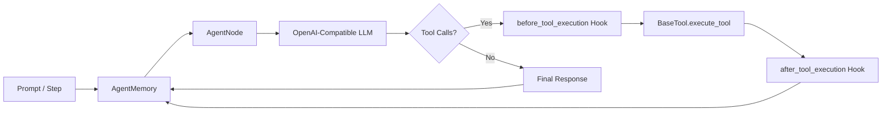

# Nexnode

> [!WARNING]
> **Active Beta Development — Feature Freeze in Effect**  
> Nexnode is undergoing initial testing, bug detection, and stability hardening.  
> **No new features will be introduced** until existing core components pass rigorous testing rounds.

A lightweight, node-based Python agent framework built for **maximum control and minimal abstraction**. Zero hidden magic, explicit state transitions, and first-class tool governance.

---

## Architecture at a Glance

Nexnode splits agent operations into explicit, inspectable primitives:

- **[`AgentConfig`](src/nexnode/core/config.py)**: Typed client settings for any OpenAI-compatible endpoint.
- **[`AgentMemory`](src/nexnode/core/memory.py)**: State-machine guarded message buffer preventing malformed API requests.
- **[`BaseTool`](src/nexnode/tool/base.py)**: Schema generator using type hints and docstrings with `{Class}__{method}` namespacing.
- **[`BaseAgentNode`](src/nexnode/core/agent.py)**: Autonomous execution loop with pre/post-execution policy hooks.
- **[`SequentialAgentNode`](src/nexnode/core/agent.py)**: Single-step execution node for human-in-the-loop validation and custom scheduling.



---

## Quickstart

### 1. Installation

Requires **Python >= 3.12**.

```bash
# Using uv
uv add nexnode

# Local development / testing setup
git clone https://github.com/S-Astralcoder/Nexnode.git
cd Nexnode
uv sync
```

---

### 2. Autonomous Agent (`BaseAgentNode`)

Runs a prompt through an automated LLM call-and-tool loop until completion or iteration limit.

```python
import os
from nexnode.core.agent import BaseAgentNode
from nexnode.core.config import AgentConfig
from nexnode.core.memory import AgentMemory

config = AgentConfig(
    base_url="https://api.openai.com/v1",
    api_key=os.environ["OPENAI_API_KEY"],
    model="gpt-4o-mini",
    temperature=0.7,
)

agent = BaseAgentNode(config=config, memory=AgentMemory())
response = agent.send_prompt("Summarize the theory of relativity in one sentence.")
print(response.choices[0].message.content)
```

---

### 3. Tool Registration & Execution

Subclass `BaseTool` and annotate methods with `@tool()`. Schemas are automatically inferred from type annotations and docstrings.

> [!NOTE]
> Tool names are formatted as `{ClassName}__{method_name}` and cannot exceed 64 characters.

```python
import os
from nexnode.core.agent import BaseAgentNode
from nexnode.core.config import AgentConfig
from nexnode.core.memory import AgentMemory
from nexnode.tool.base import BaseTool, tool


class Calculator(BaseTool):
    @tool()
    def multiply(self, a: float, b: float) -> float:
        """Multiply two floating-point numbers."""
        return a * b


agent = BaseAgentNode(
    config=AgentConfig(
        base_url="https://api.openai.com/v1",
        api_key=os.environ["OPENAI_API_KEY"],
        model="gpt-4o",
    ),
    memory=AgentMemory(),
    tools=[Calculator()],
)

response = agent.send_prompt("What is 1337 multiplied by 42?")
print(response.choices[0].message.content)
```

---

### 4. Tool Governance & Security Hooks

Intercept and veto tool calls or sanitize outputs by subclassing `BaseAgentNode`:

```python
from nexnode.core.agent import BaseAgentNode
from nexnode.exceptions import ToolCallPermissionError, ToolCallResultPermissionError
from nexnode.schema.messages import ToolCallResultMessage
from nexnode.schema.response import ChatCompletionToolCall


class SecureAgentNode(BaseAgentNode):
    def before_tool_execution(self, tool_call: ChatCompletionToolCall):
        # Deny unauthorized tool calls; reason is returned to the LLM
        if "delete" in tool_call.function.name:
            raise ToolCallPermissionError("Destructive actions are prohibited.")

    def after_tool_execution(self, tool_call_result: ToolCallResultMessage):
        # Redact sensitive payloads
        if "PRIVATE_KEY" in tool_call_result.content:
            raise ToolCallResultPermissionError("Tool output redacted due to privacy policy.")
```

---

### 5. Step-by-Step Execution (`SequentialAgentNode`)

For human-in-the-loop approvals, step debugging, or custom orchestration runtimes:

```python
import os
from nexnode.core.agent import SequentialAgentNode
from nexnode.core.config import AgentConfig
from nexnode.core.memory import AgentMemory
from nexnode.schema.messages import ToolCallResultMessage, UserMessage
from nexnode.schema.response import ChatCompletionResponse

node = SequentialAgentNode(
    config=AgentConfig(
        base_url="https://api.openai.com/v1",
        api_key=os.environ["OPENAI_API_KEY"],
        model="gpt-4o-mini",
    ),
    memory=AgentMemory(),
    tools=[Calculator()],
)

# Seed user input
node.memory.add(UserMessage(content="Calculate 84 * 12."))

# Step manually through execution states
while True:
    step = node.run_step()
    if isinstance(step, ChatCompletionResponse):
        if not step.choices[0].message.tool_calls:
            print("Final answer:", step.choices[0].message.content)
            break
        print("Model requested tool calls:", step.choices[0].message.tool_calls)
    elif isinstance(step, ToolCallResultMessage):
        print(f"Executed tool -> Result: {step.content}")
```

---

## Memory Transition Rules

`AgentMemory` rejects invalid message ordering before calling the provider API:

| Current Message in Memory | Allowed Next Message | Violation Exception |
| :--- | :--- | :--- |
| *Empty* (`None`) | `SystemMessage`, `UserMessage` | `InvalidMessageSequenceError` |
| `SystemMessage` | `SystemMessage`, `UserMessage` | `InvalidMessageSequenceError` |
| `UserMessage` | `AssistantMessage`, `ChatCompletionResponse` | `InvalidMessageSequenceError` |
| `AssistantMessage` | `ToolCallResultMessage`, `UserMessage` | `InvalidMessageSequenceError` |
| `ToolCallResultMessage` | `ToolCallResultMessage`, `UserMessage`, `ChatCompletionResponse` | `InvalidMessageSequenceError` |

---

## Exception Reference

| Exception | Raised When |
| :--- | :--- |
| `InvalidMessageSequenceError` | Message sequence violates the memory state machine. |
| `EmptyMemoryError` | Attempting a chat completion with no messages in memory. |
| `DuplicateToolError` | A tool method name collides within the same tool class. |
| `DuplicateToolClassError` | The same tool class instance is registered more than once. |
| `InvalidToolClassError` | Registered tool does not inherit from `BaseTool`. |
| `ToolNameLengthExceededError` | Generated tool identifier (`{Class}__{method}`) exceeds 64 chars. |
| `ToolCallPermissionError` | Raised in `before_tool_execution` to block execution (fed back to LLM). |
| `ToolCallResultPermissionError` | Raised in `after_tool_execution` to redact tool results. |
| `MaxIterationLimitError` | Autonomous agent loop exceeds `max_iteration`. |

---

## Beta Tester Focus Areas

Testers: please concentrate on finding breakages in these specific areas:

- [ ] **Memory Sequence Boundaries**: Pushing unusual multi-turn combinations into `AgentMemory`.
- [ ] **Sequential Node State Queue**: Parallel tool calls, errors during step popping, and re-entry behavior.
- [ ] **Tool Argument Validation**: Passing malformed, nested, or type-coerced JSON through `Pydantic` models.
- [ ] **API & Backend Parity**: Testing against local/alternative providers (Ollama, vLLM, Groq, OpenRouter).

### Submitting Bug Reports
Include:
1. Python version & OS.
2. Minimal reproducible script.
3. Complete traceback.
4. Expected vs observed behavior.
