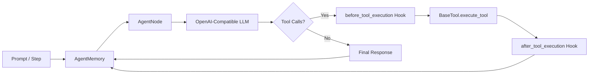

# Nexnode

A lightweight, node-based Python agent framework built for **maximum control and minimal abstraction**. Zero hidden magic, explicit state transitions, first-class tool governance, and unrestricted access to execution internals.

> [!NOTE]
> **Why "Node-Based"?**  
> Nexnode treats agents as atomic, isolated execution units ("Nodes"). Each node manages its own configuration, state, and memory invariants, designed to be connected across topologies via a forthcoming Linker layer (where inter-node handoffs can be dispatched as tool calls).

---

## Architecture at a Glance

Nexnode exposes its core engine through clean root exports and dedicated sub-namespaces:

- **[`BaseAgentNode`](src/nexnode/core/agent.py)**: Autonomous execution loop with pre/post-execution policy hooks.
- **[`SequentialAgentNode`](src/nexnode/core/agent.py)**: Single-step execution node for human-in-the-loop validation, custom scheduling, and fine-grained state manipulation.
- **[`config`](src/nexnode/core/config.py)**: Typed client settings for any OpenAI-compatible endpoint (`nexnode.config.AgentConfig`).
- **[`memory`](src/nexnode/core/memory.py)**: State-machine guarded message buffer preventing malformed API requests (`nexnode.memory.AgentMemory`).
- **[`BaseTool`](src/nexnode/tools/base.py) & [`@tool`](src/nexnode/tools/base.py)**: Schema generator using type hints and docstrings with `{Class}__{method}` namespacing.
- **[`schema.messages`](src/nexnode/schema/messages.py)**: Strictly typed conversation payloads (`SystemMessage`, `UserMessage`, `AssistantMessage`, `ToolCallResultMessage`).



---

## Message Types & Schemas

To prevent namespace clutter at the package root, message schemas reside in `nexnode.schema.messages`. Each message type enforces role boundaries and structural constraints:

| Message Class | Role | Attributes | Purpose |
| :--- | :--- | :--- | :--- |
| **`SystemMessage`** | `"system"` \| `"developer"` | `content: str`, `role: str = "system"` | Guides model behavior, system prompts, and operational personas. |
| **`UserMessage`** | `"user"` | `content: str \| list[dict]`, `role: str = "user"`, `name: str \| None = None` | User queries, multimodal input dictionaries, or external event prompts. |
| **`AssistantMessage`** | `"assistant"` | `content: str \| None`, `tool_calls: list[ChatCompletionToolCall] \| None`, `refusal: str \| None`, `extra_content: dict \| None` | Raw model generations, including planned tool invocations. |
| **`ToolCallResultMessage`** | `"tool"` | `tool_call_id: str`, `content: str`, `role: str = "tool"` | Serialized outputs or permission errors returned to the LLM following tool calls. |

> [!TIP]
> **Automatic Conversion**: You do not need to manually parse [`ChatCompletionResponse`](src/nexnode/schema/response.py) into an `AssistantMessage`. Passing a raw `ChatCompletionResponse` directly to `memory.add(response)` automatically extracts the choice message and appends it as an `AssistantMessage`.

```python
from nexnode import memory
from nexnode.schema.messages import SystemMessage, UserMessage

agent_memory = memory.AgentMemory()
agent_memory.add(SystemMessage(content="You are a precise data analysis assistant."))
agent_memory.add(UserMessage(content="Parse this quarterly report."))
```

---

## Quickstart

### 1. Installation

Requires **Python >= 3.12**.

```bash
# Using uv
uv add nexnode

# Using pip
pip install nexnode
```

---

### 2. Autonomous Agent (`BaseAgentNode`)

Runs a prompt through an automated LLM call-and-tool loop until completion or iteration limit.

```python
import os
from nexnode import BaseAgentNode, config, memory

agent_config = config.AgentConfig(
    base_url="https://api.openai.com/v1",
    api_key=os.environ["OPENAI_API_KEY"],
    model="gpt-4o-mini",
    temperature=0.7,
)

agent = BaseAgentNode(config=agent_config, memory=memory.AgentMemory())
response = agent.send_prompt("Summarize the theory of relativity in one sentence.")
print(response.choices[0].message.content)
```

---

### 3. Tool Registration & Execution

Subclass `BaseTool` and annotate methods with `@tool()`. Schemas are automatically inferred from type annotations and docstrings.

> [!NOTE]
> Tool names are formatted as `{ClassName}__{method_name}` and cannot exceed 64 characters.

```python
import os
from nexnode import BaseAgentNode, BaseTool, config, memory, tool


class Calculator(BaseTool):
    @tool()
    def multiply(self, a: float, b: float) -> float:
        """Multiply two floating-point numbers."""
        return a * b


agent = BaseAgentNode(
    config=config.AgentConfig(
        base_url="https://api.openai.com/v1",
        api_key=os.environ["OPENAI_API_KEY"],
        model="gpt-4o",
    ),
    memory=memory.AgentMemory(),
    tools=[Calculator()],
)

response = agent.send_prompt("What is 1337 multiplied by 42?")
print(response.choices[0].message.content)
```

---

### 4. Tool Governance & Security Hooks

Intercept and veto tool calls or sanitize outputs by implementing hooks on `BaseAgentNode` or `SequentialAgentNode` (both inherit from `_BaseAgentNode`):

```python
from nexnode import BaseAgentNode
from nexnode.exceptions import ToolCallPermissionError, ToolCallResultPermissionError
from nexnode.schema.messages import ToolCallResultMessage
from nexnode.schema.response import ChatCompletionToolCall


class SecureAgentNode(BaseAgentNode):
    def before_tool_execution(self, tool_call: ChatCompletionToolCall):
        # Deny unauthorized tool calls; reason is returned to the LLM
        if "delete" in tool_call.function.name:
            raise ToolCallPermissionError("Destructive actions are prohibited.")

    def after_tool_execution(self, tool_call_result: ToolCallResultMessage):
        # Redact sensitive payloads
        if "PRIVATE_KEY" in tool_call_result.content:
            raise ToolCallResultPermissionError(
                "Tool output redacted due to privacy policy."
            )
```

---

### 5. Step-by-Step Execution (`SequentialAgentNode`)

For human-in-the-loop approvals, step debugging, or custom orchestration runtimes:

```python
import os
from nexnode import BaseTool, SequentialAgentNode, config, memory, tool
from nexnode.schema.messages import ToolCallResultMessage, UserMessage
from nexnode.schema.response import ChatCompletionResponse


class Calculator(BaseTool):
    @tool()
    def multiply(self, a: float, b: float) -> float:
        """Multiply two floating-point numbers."""
        return a * b


node = SequentialAgentNode(
    config=config.AgentConfig(
        base_url="https://api.openai.com/v1",
        api_key=os.environ["OPENAI_API_KEY"],
        model="gpt-4o-mini",
    ),
    memory=memory.AgentMemory(),
    tools=[Calculator()],
)

# Seed user input
node.memory.add(UserMessage(content="Calculate 84 * 12."))

# Step manually through execution states
while True:
    step = node.run_step()
    if isinstance(step, ChatCompletionResponse):
        if not step.choices[0].message.tool_calls:
            print("Final answer:", step.choices[0].message.content)
            break
        print("Model requested tool calls:", step.choices[0].message.tool_calls)
    elif isinstance(step, ToolCallResultMessage):
        print(f"Executed tool -> Result: {step.content}")
```

---

## Low-Level Control: Accessing Internal State

Nexnode is built on a simple premise: **you own the agent, not the framework**. Unlike opinionated frameworks that seal away execution details behind inaccessible closures, Nexnode gives developers the explicit right to inspect, intercept, and modify internal attributes for advanced orchestration.

> [!CAUTION]
> **Developer Contract & Tampering Disclaimer**:  
> While internal attributes are deliberately accessible, **tampering with internal state carries zero warranty**. If an error, sequence violation, or crash occurs because you manually mutated `_internal_state`, popped/injected into `_tool_execution_queue`, or manipulated messages out of order, **that is operator mishandling, not a framework bug**. Nexnode grants you total control, but takes zero responsibility for defects caused by state tampering.

### Inspecting and Mutating `SequentialAgentNode` Internals

`SequentialAgentNode` exposes two key internal attributes:

1. **`node._internal_state`**: Dictates what action `run_step()` performs next.
   - `"AWAITING_INPUT"`: Idle state; waiting for new messages in `AgentMemory`.
   - `"AGENT_RESPONSE"`: Last step returned a final LLM text response.
   - `"AWAITING_TOOL_EXECUTION"`: The LLM requested tools; `_tool_execution_queue` has been populated.
   - `"TOOL_EXECUTION_SUCCESSFUL_NEXT"`: Tool executed successfully; ready to pop next queued call.
   - `"TOOL_EXECUTION_ERROR_NEXT"`: Tool call failed or tool not found; error surfaced.
   - `"TOOL_EXECUTION_PERMISSION_DENIED"`: Tool execution was intercepted and denied by `before_tool_execution`.
   - `"TOOL_EXECUTION_RESULT_BLOCKED"`: Tool result was intercepted and redacted by `after_tool_execution`.
   - `"TOOL_EXECUTION_END"`: All queued tools finished; ready to call completion with tool results.

2. **`node._tool_execution_queue`**: A mutable `list[ChatCompletionToolCall]` holding pending calls.
   - Inspect pending arguments before execution.
   - Reorder, throttle, or inject synthetic tool calls dynamically.
   - Clear the queue to abort remaining calls.

```python
# Inspect current node state
print(f"Current node state: {node._internal_state}")

# Abort remaining tool calls mid-flight
if node._internal_state == "AWAITING_TOOL_EXECUTION":
    print(f"Pending tool calls: {len(node._tool_execution_queue)}")
    node._tool_execution_queue.clear()
    node._internal_state = "TOOL_EXECUTION_END"
```

### Inspecting Node & Memory Primitives

- **`node.tool_class_links`**: Access the live `dict[str, BaseTool]` mapping to dynamically register or inspect tool instances.
- **`node.tools_schema`**: View the generated `list[ToolDefinition]` sent to OpenAI-compatible endpoints.
- **`memory.messages`**: The raw, ordered message buffer. Can be sliced, logged, or saved to a database for checkpointing.

---

## Memory Transition Rules

`AgentMemory` rejects invalid message ordering before calling the provider API:

| Current Message in Memory | Allowed Next Message | Violation Exception |
| :--- | :--- | :--- |
| *Empty* (`None`) | `SystemMessage`, `UserMessage` | `InvalidMessageSequenceError` |
| `SystemMessage` | `SystemMessage`, `UserMessage` | `InvalidMessageSequenceError` |
| `UserMessage` | `AssistantMessage`, `ChatCompletionResponse` | `InvalidMessageSequenceError` |
| `AssistantMessage` | `ToolCallResultMessage`, `UserMessage`, `SystemMessage` | `InvalidMessageSequenceError` |
| `ToolCallResultMessage` | `ToolCallResultMessage`, `UserMessage`, `AssistantMessage`, `ChatCompletionResponse`, `SystemMessage` | `InvalidMessageSequenceError` |

---

## Exception Reference

| Exception | Raised When |
| :--- | :--- |
| `InvalidMessageSequenceError` | Message sequence violates the memory state machine. |
| `EmptyMemoryError` | Attempting a chat completion with no messages in memory. |
| `DuplicateToolError` | A tool method name collides within the same tool class. |
| `DuplicateToolClassError` | The same tool class instance is registered more than once. |
| `InvalidToolClassError` | Registered tool does not inherit from `BaseTool`. |
| `ToolNameLengthExceededError` | Generated tool identifier (`{Class}__{method}`) exceeds 64 chars. |
| `ToolCallPermissionError` | Raised in `before_tool_execution` to block execution (fed back to LLM). |
| `ToolCallResultPermissionError` | Raised in `after_tool_execution` to redact tool results. |
| `MaxIterationLimitError` | Autonomous agent loop exceeds `max_iteration`. |

---

## Testing, Verification & Bug Reporting

Version 1 is backed by an automated test suite verifying edge cases, state transitions, tool execution, and error handling. CI runs static checks (`ruff`, `pyright`) on every push via `check.yml` and executes test suites via `run_test.yml`.

### Running Tests Locally

```bash
# Run the test suite
uv run pytest

# Run linting and type checking
uv run ruff check src tests
uv run pyright
```

### Community Testing Focus Areas

Testing and stabilization remain ongoing priorities. Testers and early adopters are encouraged to stress-test the following boundaries:

- [ ] **Complex Multi-Turn Conversations**: Testing deeply nested alternating or branched message flows in `AgentMemory`.
- [ ] **Tool Argument Edge Cases**: Passing nested objects, optional types, or coerced structures through `BaseTool`.
- [ ] **Alternative Provider Compatibility**: Testing against local or non-OpenAI endpoints (Ollama, vLLM, Groq, OpenRouter).
- [ ] **State Queue Interception**: Exercising sequential tool queue manipulation under high concurrency or early abort conditions.

### Submitting Bug Reports

> [!IMPORTANT]
> **What is NOT a Bug**: Failures or desynchronizations resulting from manually overriding or tampering with internal attributes (`_internal_state`, `_tool_execution_queue`, etc.) are classified as operator mishandling, not framework bugs. Do not file bug reports for issues arising from custom state mutation unless the defect reproduces on clean, untampered node runs.

When reporting an issue, please include:
1. Python version (`python --version`) and OS.
2. Minimal reproducible script.
3. Complete traceback.
4. Expected vs observed behavior.
